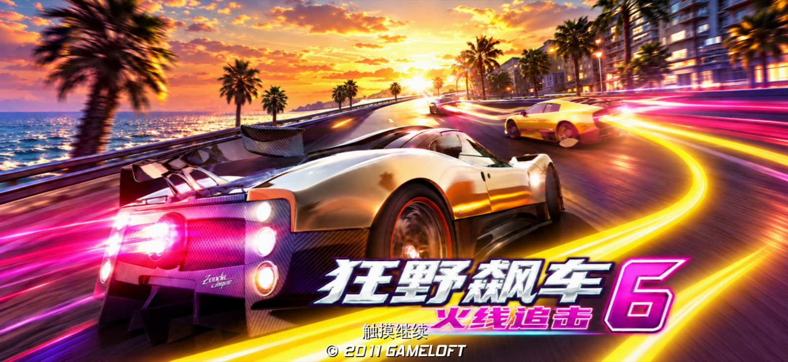
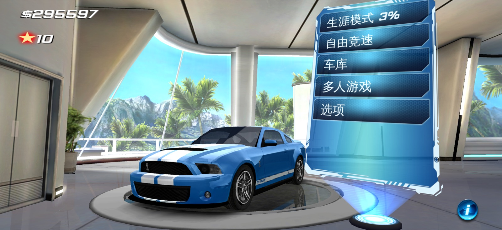
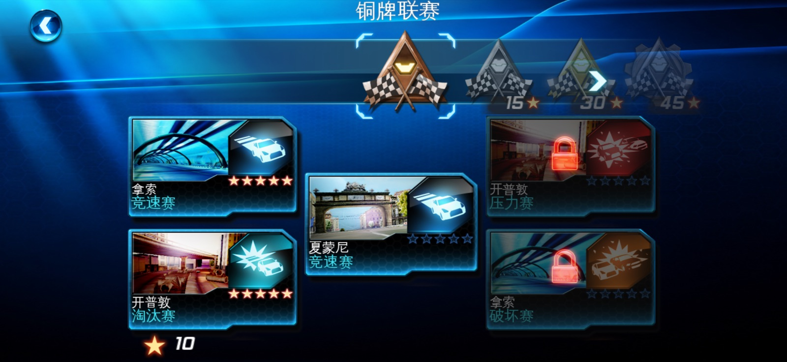
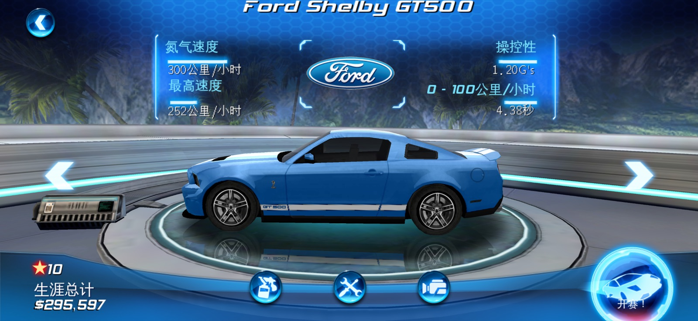
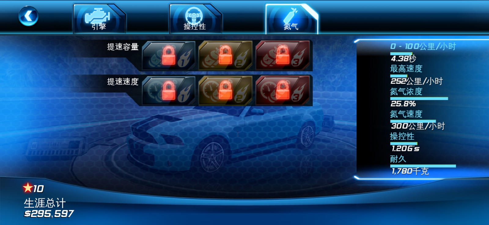
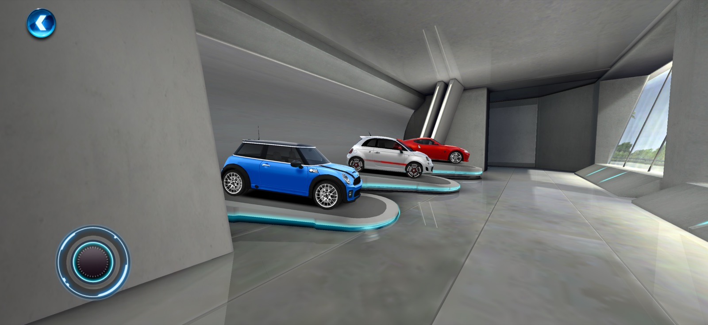
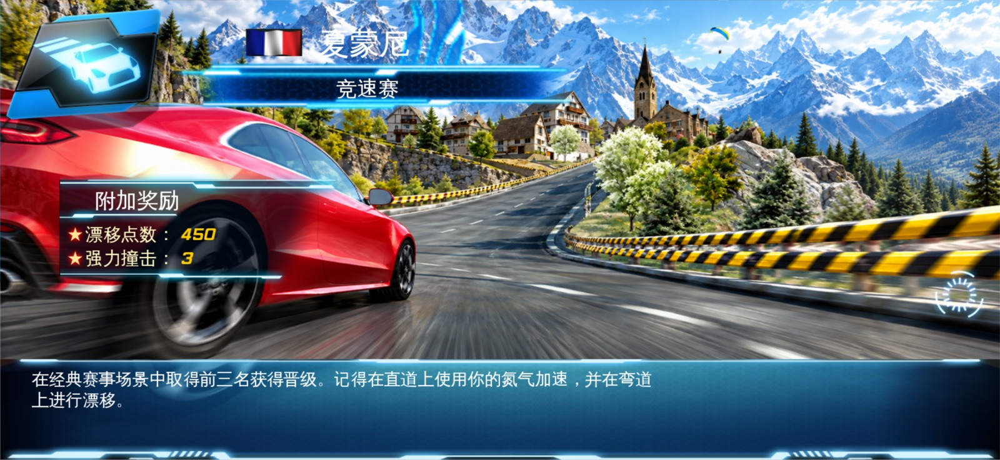
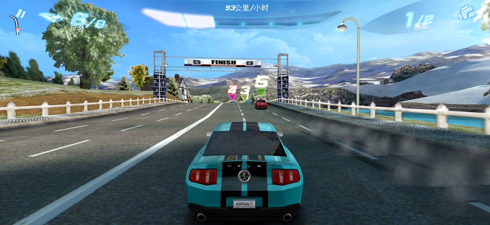
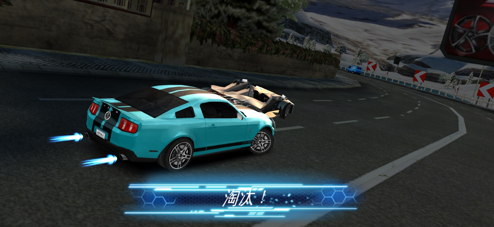
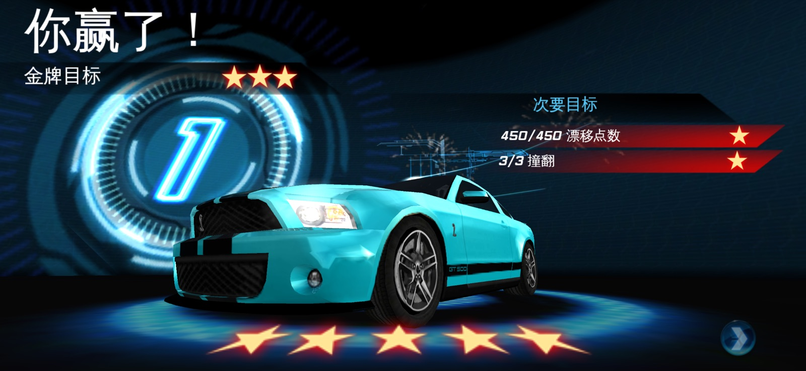

# Asphalt 6 arm64 兼容层

**中文** | [English](README-en.md)

让《狂野飙车 6》（Asphalt 6: Adrenaline，iOS 1.3.2，2011 年）在现代 iPhone（arm64，iOS 17 及以上）上运行的兼容层。

本仓库只包含兼容层代码，不包含游戏程序、美术或音频。你需要自备游戏 IPA，在自己的 Mac 上构建出可安装的 App。

## 特性

- 在 arm64 iPhone 上运行原版 1.3.2 游戏，实测比赛中约 60 fps（其实是）
- 适配全面屏与安全区，3D 画面按屏幕真实比例显示，界面不拉伸；生涯、自由竞速与多人游戏所在的办公室显示器同样铺满屏幕
- 多人游戏：本地 WiFi 可进入并输入用户名（两台设备联机尚未实测）；在线（Gameloft Live 已停服）与蓝牙不可用，按钮显示为灰色
- 信息页的 Twitter 入口改为打开 Gameloft 在 X 上的主页
- 适配当前的 OpenGL ES 驱动
- 移除已停止服务的商店、推广与 iPod 音乐播放器入口，App 不申请音乐库权限
- 可选的高清背景包（16:9 与全面屏 2.2:1）

## 截图

iPhone 17 Pro 实机截图，已装高清背景包。

| | |
| --- | --- |
|  |  |
| 标题画面 | 主菜单 |
|  |  |
| 生涯联赛 | 选车 |
|  |  |
| 改装 | 车库 |
|  |  |
| 比赛加载 | 比赛中 |
|  |  |
| 淘汰 | 比赛结算 |

## 工作原理

构建时，游戏的 ARMv7 程序经 Ghidra 分析后被一次性转换为 C++ 源码，再由 Xcode 编译为 arm64 代码，与兼容层一起链接进 App。运行时不生成或解释任何代码（没有 JIT）。

转换后的代码逐条保持与原版 ARMv7 指令一致的行为，包括寄存器、32 位内存空间、条件标志与浮点运算。游戏用到的 iOS 3/4 时代系统接口（UIKit、OpenGL ES、音频、触控、重力感应等）由兼容层基于现代 iOS 接口重新实现。

构建的每个中间结果都有固定校验值，同一 IPA 在任何 Mac 上得到的转换结果逐字节相同。

## 环境要求

- Apple Silicon Mac
- Xcode（含 iOS 17 及以上 SDK）
- CMake 3.20 及以上
- Python 3.9 及以上

Python 依赖、Ghidra 12.1.4 与 JDK 21 会在首次构建时自动下载到 `build/`。

### 支持的游戏版本

仅支持 **Asphalt 6 1.3.2**（p.s. 因为我一开始就下的1.3.2，不想折腾了）。IPA 可以自行在 Archive.org 搜索获取。

| 项目 | 值 |
| --- | --- |
| IPA 文件 | `Asphalt_6__Adrenaline_1.3.2_ios_3.1.3.ipa`（564,685,789 字节） |
| IPA SHA-256 | `30ea95d5ccd3fb9ded3b7b6b0c9e88f6af8de62d8c841ed0a3f79be6d045a796` |
| 游戏程序 ARMv7 部分 SHA-256 | `4a2209881ab5933113a15770b0615807cfa7d73bf50a9326569a7ed20f77df00` |

构建脚本校验的是游戏程序 ARMv7 部分的哈希，重新打包过的 IPA 只要其中的程序一致即可使用。

## 构建

```sh
python3 scripts/buildGame.py /path/to/Asphalt6.ipa
```

完整构建约 1.5–2.5 小时，大部分时间用于编译。产物位于 `dist/`：

| 文件 | 说明 |
| --- | --- |
| `Asphalt6ARM64.ipa` | 未签名的 App，用 SideStore、AltStore 等工具签名安装 |
| `Asphalt6Data.zip` | 游戏资源包 |

| 参数 | 说明 |
| --- | --- |
| `--jobs N` | 编译并行数，默认为 CPU 核数的一半 |
| `--debug` | 编译时带调试信息 |

## 安装

1. 签名并安装 `Asphalt6ARM64.ipa`，打开一次。
2. 在“文件”App 中，把 `Asphalt6Data.zip` 放进 **我的 iPhone → Asphalt 6**，无需解压。
3. 再次打开 App，资源会自动解压并校验，完成后进入游戏。

### 高清背景包（可选）

高清背景包 `NativeArtwork.zip` 已单独上传到 Google Drive：[点此下载](https://drive.google.com/file/d/1o8iHwtRP0q2xYJgAp07VcnXXSXm7BQE5/view?usp=sharing)。把它和资源包放在同一目录，启动时会自动安装，标题、菜单与加载画面改用高清背景，全面屏机型使用 2.2:1 版本；没有时使用原版背景。

高清背景以游戏原版背景为基础，使用 GPT Image 2 重绘为 16:9 与 2.2:1 两种画幅。

## 测试

测试设备：iPhone 17 Pro（iOS 27.0）。暂不支持 iPhone Duo。

| 功能 | 状态 |
| --- | --- |
| 生涯模式 | ✅ 正常 |
| 单人游戏 | ✅ 正常 |
| 联机 | ⚠️ 未测试 |

帧率（生涯第 1 场 · 拿索，完整比赛）：

| 版本 | 平均帧率 | 平均每帧耗时 |
| --- | --- | --- |
| 基础版本 | 约 36 fps | 25.3 ms |
| + 寄存器优化 | 约 53 fps | 18.7 ms |
| + 外部调用与间接跳转缓存 | 约 57 fps | 17.4 ms |
| + NEON 单精度硬件快速路径（当前） | 约 60 fps | 16.6 ms |

## 版权声明

《狂野飙车 6》（Asphalt 6: Adrenaline）的游戏程序、美术、音频及相关商标归 Gameloft 所有。本项目与 Gameloft 无关，不包含也不分发任何游戏内容。高清背景包中的图片基于原版背景，借助 GPT Image 2 重绘，其画面内容与美术设计同样归 Gameloft 所有。

## 许可

- 兼容层代码以 [MIT 许可证](LICENSE) 发布（`aot/math/` 除外）。
- `aot/math/` 源自 QEMU SoftFloat，沿用其 SoftFloat-2a / BSD / GPL-2.0-or-later 许可，详见 [`aot/math/NOTICE.md`](aot/math/NOTICE.md)。
